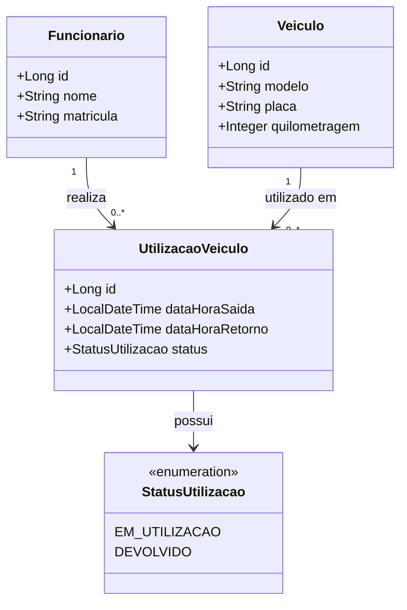

# Controle de Veículos

Documento de visão e acompanhamento do projeto — SENAI.

**Projeto atualizado com as funcionalidades da Sprint 4 — Painel de Indicadores e Lista de Atenção.**

| Campo | Informação |
|---|---|
| **Aluno** | Vitor Emanuel de Lima Vodinciar |
| **Turma** | TEC-N-001788/2026 |
| **Opção escolhida** | Proposta própria |
| **Versão atual** | 0.4.0 |
| **Previsão de entrega da versão 1.0** | 11/11/2026 |

---

## 1. Visão geral

### 1.1 Problema

Atualmente, a empresa não possui controle organizado sobre quem utiliza seus veículos, nem informações precisas sobre quando e por quanto tempo eles foram utilizados.

Essa falta de rastreabilidade dificulta a análise de trajetos demorados e a identificação de quem utilizava um veículo no momento de uma multa ou de uma possível ocorrência de dano.

Também prejudica o acompanhamento do histórico de utilização da frota.

O sistema permitirá registrar e consultar essas informações para apoiar a gestão dos veículos.

### 1.2 Canvas do projeto

| Bloco | Resposta |
|---|---|
| **Usuários** | Funcionários que utilizam os veículos, operadores e administradores responsáveis pela frota. |
| **Problema** | Falta de registros organizados sobre os responsáveis pelos veículos e os períodos de utilização. |
| **Proposta de valor** | Facilitar o acompanhamento da frota, a análise dos períodos de utilização e a apuração de ocorrências. |
| **Funcionalidades principais** | Cadastro de funcionários e veículos, registro de saída e retorno, consulta do histórico, controle de acesso e painel de indicadores. |
| **Informações armazenadas** | Funcionários, matrículas, veículos, placas, quilometragem, datas e horários de utilização e situação dos registros. |
| **Indicadores implementados** | Total de veículos cadastrados, veículos em utilização, veículos disponíveis e total de utilizações registradas. |
| **Restrições** | Projeto individual, Java 21, Spring Boot 4 e entrega da versão 1.0 em 11/11/2026. |

---

## 2. Requisitos

### 2.1 Requisitos funcionais

| ID | Requisito | Nível |
|---|---|---|
| RF01 | Cadastrar, consultar, editar e excluir funcionários e veículos, respeitando os vínculos existentes. | Essencial |
| RF02 | Registrar a utilização de um veículo, informando funcionário, veículo, data e horário de saída. | Essencial |
| RF03 | Registrar a data e o horário de retorno do veículo. | Essencial |
| RF04 | Consultar o histórico de utilização dos veículos. | Essencial |
| RF05 | Permitir autenticação por usuário e senha. | Essencial |
| RF06 | Controlar as permissões conforme os perfis ADMIN e OPERADOR. | Essencial |
| RF07 | Exibir painel com indicadores de utilização da frota e lista de atenção das utilizações em aberto. | Essencial |

### 2.2 Requisitos não funcionais

| ID | Requisito |
|---|---|
| RNF01 | O sistema deve funcionar como aplicação web acessível pelo navegador. |
| RNF02 | O sistema deve exigir autenticação por login e senha. |
| RNF03 | As senhas devem ser armazenadas utilizando hashes seguros, com BCrypt. |
| RNF04 | A interface deve utilizar Thymeleaf e Bootstrap 5. |

### 2.3 Regras de negócio

| ID | Regra |
|---|---|
| RN01 | Toda utilização deve estar vinculada a um funcionário e a um veículo cadastrados. |
| RN02 | O retorno não pode ocorrer antes da saída. |
| RN03 | Um veículo não pode possuir duas utilizações em aberto simultaneamente. |
| RN04 | Somente administradores podem cadastrar, editar e excluir funcionários e veículos. |
| RN05 | Administradores e operadores podem registrar saídas e devoluções. |
| RN06 | Usuários sem permissão não podem acessar funcionalidades restritas. |
| RN07 | O painel deve calcular os veículos disponíveis com base na quantidade cadastrada e nas utilizações em aberto. |

### 2.4 Situação da utilização

Cada utilização possui uma situação definida automaticamente pelo sistema.

| Situação | Descrição |
|---|---|
| EM_UTILIZACAO | O veículo foi retirado e ainda não possui retorno registrado. |
| DEVOLVIDO | O veículo já possui data e horário de retorno. |

As situações são representadas pelo enum `StatusUtilizacao`, armazenado como texto no banco de dados.

Na listagem, as situações são identificadas por cores, e o botão de devolução fica disponível para utilizações em aberto.

---

## 3. Histórias de usuário

### HU01 — Cadastro de funcionários e veículos

Como administrador, quero cadastrar funcionários e veículos para manter os dados necessários ao controle da frota.

**Critérios de aceite:**

- Cadastrar funcionários com nome e matrícula.
- Cadastrar veículos com modelo, placa e quilometragem.
- Consultar os registros cadastrados.
- Permitir edição e exclusão conforme as regras de negócio.

### HU02 — Registro de utilização

Como operador, quero registrar a utilização de um veículo para identificar quem está utilizando cada veículo da empresa.

**Critérios de aceite:**

- Selecionar funcionário e veículo cadastrados.
- Informar data e horário de saída.
- Impedir a retirada de veículos que já estejam em utilização.
- Permitir registrar a devolução.

### HU03 — Consulta do histórico

Como administrador, quero consultar o histórico de utilização dos veículos para identificar os responsáveis e verificar os períodos de utilização.

**Critérios de aceite:**

- Exibir funcionário responsável e veículo utilizado.
- Exibir data e horário de saída.
- Exibir data e horário de retorno.
- Identificar utilizações em aberto.
- Manter registros anteriores disponíveis para consulta.

### HU04 — Controle de acesso

Como administrador, quero controlar o acesso às funcionalidades para impedir alterações não autorizadas.

**Critérios de aceite:**

- Exigir login e senha.
- Identificar o usuário autenticado.
- Diferenciar os perfis ADMIN e OPERADOR.
- Restringir funcionalidades administrativas.
- Exibir uma página personalizada quando o acesso for negado.

### HU05 — Painel de indicadores

Como administrador ou operador, quero visualizar indicadores sobre os veículos para acompanhar a situação atual da frota.

**Critérios de aceite:**

- Exibir a quantidade total de veículos cadastrados.
- Exibir a quantidade de veículos em utilização.
- Exibir a quantidade de veículos disponíveis.
- Exibir a quantidade total de utilizações registradas.
- Atualizar os indicadores ao recarregar a página após uma saída ou devolução.
- Disponibilizar acesso rápido às principais funcionalidades.
- Exibir uma lista de atenção com utilizações ainda não devolvidas, ordenadas pela saída mais antiga.

---

## 4. Modelo de dados



Cada utilização está vinculada a um funcionário e a um veículo.

Um funcionário pode realizar várias utilizações, e um veículo pode ter várias utilizações no histórico, desde que não possua duas utilizações em aberto simultaneamente.

O campo `status` representa a situação da utilização por meio do enum `StatusUtilizacao`.

---

## 5. Segurança e perfis de acesso

A autenticação foi implementada utilizando Spring Security.

O sistema exige login e senha antes de permitir o acesso às funcionalidades protegidas.

### 5.1 Perfis disponíveis

O sistema possui dois perfis:

**ADMIN — Administrador**

Responsável pelo gerenciamento dos cadastros e pelo acompanhamento das utilizações.

**OPERADOR — Operador**

Responsável pelo registro das saídas e devoluções dos veículos e pela consulta das informações cadastradas.

### 5.2 Permissões

| Funcionalidade | ADMIN | OPERADOR |
|---|---|---|
| Consultar funcionários | Sim | Sim |
| Cadastrar funcionários | Sim | Não |
| Editar funcionários | Sim | Não |
| Excluir funcionários | Sim | Não |
| Consultar veículos | Sim | Sim |
| Cadastrar veículos | Sim | Não |
| Editar veículos | Sim | Não |
| Excluir veículos | Sim | Não |
| Consultar utilizações | Sim | Sim |
| Registrar saída | Sim | Sim |
| Registrar devolução | Sim | Sim |
| Excluir utilização, quando disponível | Sim | Não |
| Gerenciar usuários, quando disponível | Sim | Não |
| Visualizar painel de indicadores | Sim | Sim |

### 5.3 Página de acesso negado

Quando um usuário tenta acessar uma funcionalidade sem permissão, o sistema retorna o código HTTP `403 — Forbidden`.

Foi implementada uma página personalizada que apresenta a mensagem:

**Acesso negado**

O seu perfil não tem permissão para acessar esta página ou realizar esta ação.

A página também apresenta um botão para retornar ao início do sistema.

### 5.4 Interface conforme o perfil

O sistema utiliza `sec:authorize` do Thymeleaf para controlar a exibição de elementos da interface.

Os botões de cadastro, edição e exclusão de funcionários e veículos são apresentados somente aos administradores.

O menu também identifica o usuário autenticado e seu perfil.

A ocultação dos botões complementa as regras de autorização configuradas no Spring Security.

---

## 6. Painel de indicadores

### 6.1 Objetivo

O painel de indicadores foi desenvolvido no Encontro 8 para facilitar o acompanhamento da frota de veículos.

A página inicial apresenta informações resumidas e atualizadas com base nos registros existentes no banco de dados.

### 6.2 Indicadores implementados

**1. Veículos cadastrados**

Apresenta a quantidade total de veículos registrados no sistema.

**2. Veículos em utilização**

Apresenta a quantidade de veículos que possuem uma utilização em aberto, sem data de retorno.

**3. Veículos disponíveis**

Apresenta a quantidade de veículos cadastrados que não estão em utilização.

O cálculo é realizado por:

`Disponíveis = Total de veículos - Veículos em utilização`

**4. Total de utilizações**

Apresenta a quantidade total de registros de utilização, incluindo os registros finalizados e aqueles ainda em aberto.

### 6.3 Implementação

O painel utiliza as tecnologias já presentes no projeto:

- Java 21.
- Spring Boot 4.
- Spring MVC.
- Thymeleaf.
- Bootstrap 5.
- Spring Data JPA.
- Banco de dados H2.

O arquivo `InicioController.java` consulta as informações utilizando os serviços existentes.

O `VeiculoService` fornece a lista de veículos cadastrados.

O `UtilizacaoVeiculoService` fornece o histórico de utilizações.

Os veículos em utilização são identificados pelos registros que ainda não possuem data de retorno.

Os valores calculados são enviados para a página `index.html` por meio do `Model` do Spring MVC.

### 6.4 Interface visual

A página inicial apresenta quatro cartões com os indicadores da frota.

Cada cartão possui um ícone, uma descrição e o número correspondente.

O painel também apresenta a **Lista de Atenção — Veículos em utilização**, mostrando:

- Funcionário responsável.
- Modelo do veículo.
- Data e hora da saída.
- Situação da utilização.

A lista é ordenada pela data de saída, das utilizações mais antigas para as mais recentes.

Quando não houver utilizações em aberto, aparece a mensagem:

**Nenhum veículo com utilização em aberto.**

O painel também possui uma seção de acesso rápido com os seguintes botões:

- Ver veículos.
- Ver utilizações.
- Ver funcionários.
- Diagnóstico.

O layout utiliza Bootstrap 5 e mantém o menu e o rodapé existentes.

### 6.5 Atualização das informações

Os indicadores são calculados novamente quando a página inicial é acessada ou recarregada.

Após o registro de uma devolução, a quantidade de veículos em utilização diminui e a quantidade de veículos disponíveis aumenta.

O histórico total de utilizações permanece inalterado pela devolução.

A Lista de Atenção é atualizada com base nas utilizações que ainda não possuem retorno registrado.

---

## 7. Como executar

### 7.1 GitHub Codespaces

1. Abra o repositório no GitHub.
2. Clique em **Code → Codespaces**.
3. Abra o Codespace existente ou crie um novo.
4. Aguarde a preparação do ambiente.
5. No terminal, execute:

```bash
mvn spring-boot:run -Dspring-boot.run.profiles=dev
```

6. Aguarde a mensagem `Started SistemaApplication`.
7. Abra a aba **Portas**.
8. Na porta `8080`, clique no ícone de globo para abrir a aplicação.
9. Utilize uma das contas de demonstração.

Para encerrar a aplicação, pressione `Ctrl + C` no terminal.

### 7.2 Execução no computador

**Requisitos:**

- JDK 21.
- Maven.
- IntelliJ IDEA ou VS Code com suporte a Java.

Abra o projeto na IDE e execute a classe `SistemaApplication` ou utilize:

```bash
mvn spring-boot:run -Dspring-boot.run.profiles=dev
```

A aplicação ficará disponível em `http://localhost:8080`.

### 7.3 Usuários de demonstração

| Usuário | Senha | Perfil |
|---|---|---|
| admin | admin123 | ADMIN |
| operador | operador123 | OPERADOR |

Essas credenciais são destinadas exclusivamente ao ambiente de demonstração e desenvolvimento. Devem ser substituídas antes de qualquer utilização em produção.

### 7.4 Banco de dados

Durante o desenvolvimento, o sistema utiliza H2 com persistência em arquivo.

Configuração principal:

```yaml
spring:
  datasource:
    url: "jdbc:h2:file:./dados/banco;MODE=MySQL;DATABASE_TO_LOWER=TRUE;CASE_INSENSITIVE_IDENTIFIERS=TRUE"
    username: sa
    password: ""
```

O banco mantém os registros entre as execuções da aplicação.

A pasta `dados/` contém o banco de desenvolvimento e não deve ser enviada ao GitHub.

---

## 8. Tecnologias

| Tecnologia | Utilização |
|---|---|
| Java 21 | Linguagem de programação |
| Spring Boot 4 | Estrutura principal da aplicação |
| Spring MVC | Controllers e requisições web |
| Spring Data JPA | Persistência de dados |
| H2 | Banco de dados de desenvolvimento |
| MySQL | Banco de dados previsto para produção |
| Thymeleaf | Renderização das páginas |
| Bootstrap 5 | Interface responsiva |
| Spring Security | Autenticação e autorização |
| BCrypt | Hash de senhas |
| Maven | Gerenciamento de dependências |
| Git e GitHub | Versionamento do projeto |

---

## 9. Testes realizados

### Sprint 2 — Controle de utilizações

- Cadastro e consulta de funcionários.
- Cadastro e consulta de veículos.
- Registro de saída de veículos.
- Registro de devolução.
- Bloqueio de utilização simultânea do mesmo veículo.
- Consulta do histórico de utilizações.
- Identificação visual das situações.

### Sprint 3 — Segurança

- Exibição da tela de login.
- Autenticação com usuário OPERADOR.
- Bloqueio do acesso a `/funcionarios/novo` para OPERADOR.
- Bloqueio do acesso a `/veiculos/novo` para OPERADOR.
- Exibição da página personalizada de erro 403.
- Ocultação dos botões administrativos na lista de funcionários.
- Ocultação dos botões administrativos na lista de veículos.
- Exibição do perfil OPERADOR no menu.

**Testes adicionais realizados no Encontro 9:**

- Cadastro, edição e exclusão de funcionário de teste.
- Validação dos campos obrigatórios de funcionário.
- Cadastro, edição e exclusão de veículo de teste.
- Validação dos campos obrigatórios de veículo.
- Registro de saída de veículo.
- Bloqueio de uma segunda saída do mesmo veículo.
- Registro de devolução.
- Atualização dos indicadores após a devolução.
- Verificação da restrição de acesso do OPERADOR.

### Sprint 4 — Painel de indicadores

O painel foi implementado e testado em 04/11/2026.

**Teste inicial:**

| Indicador | Resultado |
|---|---|
| Veículos cadastrados | 3 |
| Veículos em utilização | 2 |
| Veículos disponíveis | 1 |
| Total de utilizações | 5 |

**Teste após as devoluções:**

| Indicador | Resultado |
|---|---|
| Veículos cadastrados | 3 |
| Veículos em utilização | 0 |
| Veículos disponíveis | 3 |
| Total de utilizações | 5 |

**Teste adicional do Encontro 9:**

Após registrar e devolver outro veículo:

| Indicador | Resultado |
|---|---|
| Veículos cadastrados | 3 |
| Veículos em utilização | 0 |
| Veículos disponíveis | 3 |
| Total de utilizações | 6 |

**Resultados:**

- Os indicadores foram exibidos corretamente.
- As quantidades corresponderam aos registros existentes.
- O sistema reconheceu as devoluções.
- A quantidade de veículos disponíveis foi atualizada.
- O total de utilizações permaneceu correto após as devoluções.
- O painel funcionou com o perfil OPERADOR.
- Os botões de acesso rápido foram apresentados na interface.
- A Lista de Atenção foi exibida corretamente quando não havia utilizações em aberto.
- O bloqueio de uma segunda saída para o mesmo veículo foi testado.

Os testes confirmaram o funcionamento dos cálculos implementados no painel.

---

## 10. Uso de inteligência artificial

Durante o desenvolvimento, foi utilizado o ChatGPT como ferramenta de apoio para:

- Compreender conceitos de Java e Spring Boot.
- Interpretar requisitos do projeto.
- Auxiliar na implementação de funcionalidades.
- Identificar e corrigir problemas no código.
- Compreender as regras de autenticação e autorização.
- Organizar e atualizar a documentação.
- Auxiliar na construção do painel de indicadores.
- Interpretar os resultados dos testes.

O desenvolvimento foi acompanhado por testes manuais no ambiente GitHub Codespaces.

---

## 11. Histórico de versões

| Versão | Data | Descrição |
|---|---|---|
| 0.1.0 | A preencher | Criação do projeto e elaboração do documento de visão. |
| 0.2.0 | 21/10/2026 | Desenvolvimento dos cadastros, registro de utilizações, devoluções e regras de negócio. |
| 0.3.0 | 01/11/2026 | Implementação de login, perfis de acesso, página 403 e controle visual de permissões. |
| 0.4.0 | 04/11/2026 | Implementação do painel de indicadores, lista de atenção, interface visual e testes de atualização após devoluções. |

---

## 12. Próximas etapas

- Realizar os testes finais das permissões administrativas.
- Verificar as funcionalidades com os perfis ADMIN e OPERADOR.
- Manter as evidências do AVA 4, já entregue, disponíveis na pasta `docs`.
- Completar o checklist do AVA 5 e atualizar o Kanban.
- Revisar os requisitos e corrigir eventuais problemas.
- Preparar a versão final do projeto.
- Concluir a versão 1.0 até 11/11/2026.

---

## 13. Situação atual do projeto

**Versão:** 0.4.0

**Data da atualização:** 04/11/2026

**Funcionalidades implementadas:**

- Cadastro de funcionários.
- Cadastro de veículos.
- Registro de utilização de veículos.
- Registro de devolução.
- Histórico de utilizações.
- Controle de disponibilidade dos veículos.
- Autenticação por login e senha.
- Perfis de acesso ADMIN e OPERADOR.
- Página personalizada de acesso negado.
- Painel com quatro indicadores da frota.
- Lista de Atenção com utilizações em aberto.
- Acesso rápido às funcionalidades principais.

O projeto permanece em desenvolvimento, com entrega da versão 1.0 prevista para 11/11/2026.

---

## 14. Funcionalidades e telas

### 14.1 Funcionalidades principais

- Cadastro, consulta, edição e exclusão de funcionários e veículos, conforme o perfil.
- Registro de saída e devolução de veículos.
- Histórico de utilizações, com funcionário, veículo, datas, horários e situação.
- Bloqueio de duas utilizações simultâneas do mesmo veículo.
- Login, autorização por perfil e página de acesso negado (HTTP 403).
- Painel com quatro indicadores e Lista de Atenção para utilizações sem retorno.

### 14.2 Capturas de tela

**Painel de indicadores e Lista de Atenção**


**Histórico de utilizações**


**Tela de login**


**Diferença entre os perfis — Funcionários**


**Diferença entre os perfis — Veículos**


**Regra de negócio — bloqueio de utilização duplicada**

A regra RN03 foi testada: uma segunda saída para um veículo ainda não devolvido é impedida.

A captura `docs/regra.png` deverá ser adicionada à documentação quando for produzida. Não há link para essa imagem por enquanto para evitar imagem quebrada no GitHub.

---

## 15. Checklist do nível essencial — AVA 5

Marque `[x]` apenas quando o item tiver sido verificado. Itens pendentes permanecem com `[ ]`.

- [x] Sistema inicia pelo Codespaces, sem erros nos testes realizados.
- [x] Cadastro de funcionários: listar, cadastrar, editar, excluir e validar campos obrigatórios.
- [x] Cadastro de veículos: listar, cadastrar, editar, excluir e validar campos obrigatórios.
- [x] Utilizações vinculadas a funcionários e veículos cadastrados.
- [x] Regra RN03: impedir duas utilizações em aberto para o mesmo veículo.
- [x] Registro de devolução e atualização da disponibilidade.
- [x] Login e dois perfis com permissões diferentes.
- [x] Operador bloqueado ao acessar diretamente a página de cadastro restrita (HTTP 403).
- [x] Painel com quatro indicadores, calculados com dados do sistema.
- [x] Lista de Atenção exibida no painel.
- [x] Histórico de commits no GitHub.
- [x] README com visão do projeto, instruções de execução, usuários de demonstração, funcionalidades e capturas de tela.
- [ ] Testar explicitamente a RN02: impedir devolução com data anterior à saída.
- [ ] Confirmar a regra RN01 e as restrições de exclusão de registros vinculados.
- [ ] Conferir se todas as imagens aparecem corretamente no README publicado no GitHub.
- [ ] Realizar revisão de usabilidade por um colega e registrar observações.
- [ ] Atualizar e conferir o Kanban no GitHub Projects.
- [ ] Verificar se a tag `base-essencial` foi criada e enviada ao GitHub.

**Próxima entrega:** AVA 5 até o início do Encontro 10, em 11/11/2026, com link do repositório, README completo, checklist e Kanban atualizado.
