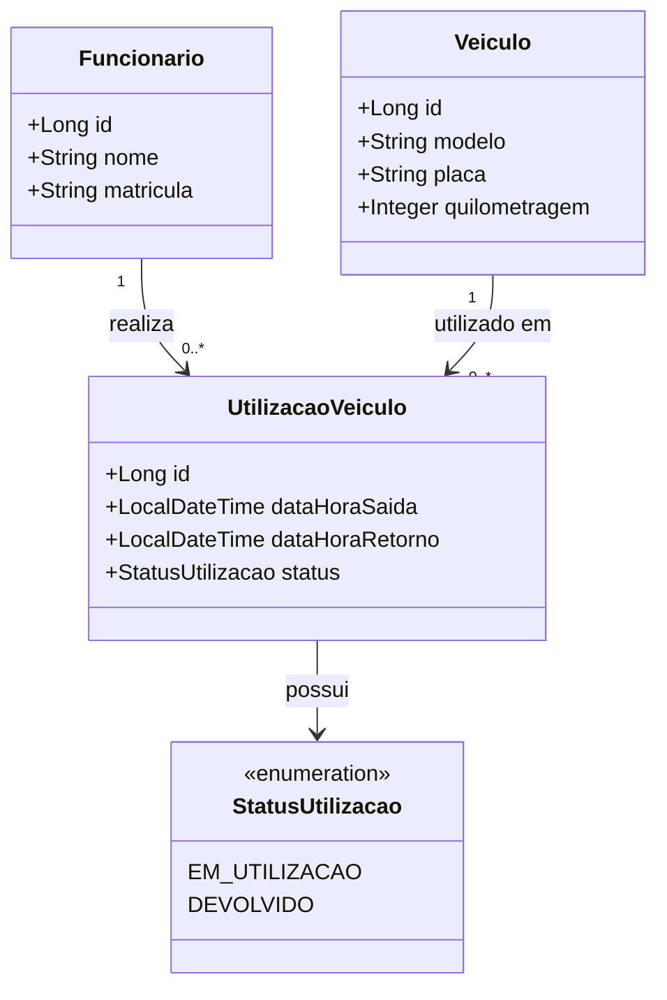

# Controle de Veículos

Documento de visão e acompanhamento do projeto — SENAI.

**Projeto atualizado com as funcionalidades da Sprint 3 — Segurança, Login e Perfis de Acesso.**

| Campo | Informação |
|---|---|
| **Aluno** | Vitor Emanuel de Lima Vodinciar |
| **Turma** | TEC-N-001788/2026 |
| **Opção escolhida** | Proposta própria |
| **Versão atual** | 0.3.0 |
| **Previsão de entrega da versão 1.0** | 11/11/2026 |

---

## 1. Visão geral

### 1.1 Problema

Atualmente, a empresa não possui controle organizado sobre quem utiliza seus veículos, nem informações precisas sobre quando e por quanto tempo eles foram utilizados.

Essa falta de rastreabilidade dificulta a análise de trajetos demorados e a identificação de quem utilizava um veículo no momento de uma multa ou de uma possível ocorrência de dano.

Também prejudica o acompanhamento do histórico de utilização da frota.

O sistema permitirá registrar e consultar essas informações para apoiar a gestão dos veículos.

### 1.2 Canvas do projeto

| Bloco | Resposta |
|---|---|
| **Usuários** | Funcionários que utilizam os veículos, operadores e administradores responsáveis pela frota. |
| **Problema** | Falta de registros organizados sobre os responsáveis pelos veículos e os períodos de utilização. |
| **Proposta de valor** | Facilitar o acompanhamento da frota, a análise dos períodos de utilização e a apuração de ocorrências. |
| **Funcionalidades principais** | Cadastro de funcionários e veículos, registro de saída e retorno, consulta do histórico e controle de acesso. |
| **Informações armazenadas** | Funcionários, matrículas, veículos, placas, quilometragem, datas e horários de utilização e situação dos registros. |
| **Indicadores previstos** | Quem utilizou cada veículo, datas e horários de utilização e duração das utilizações concluídas. |
| **Restrições** | Projeto individual, Java 21, Spring Boot 4 e entrega da versão 1.0 em 11/11/2026. |

---

## 2. Requisitos

### 2.1 Requisitos funcionais

| ID | Requisito | Nível |
|---|---|---|
| RF01 | Cadastrar, consultar, editar e excluir funcionários e veículos, respeitando os vínculos existentes. | Essencial |
| RF02 | Registrar a utilização de um veículo, informando funcionário, veículo, data e horário de saída. | Essencial |
| RF03 | Registrar a data e o horário de retorno do veículo. | Essencial |
| RF04 | Consultar o histórico de utilização dos veículos. | Essencial |
| RF05 | Permitir autenticação por usuário e senha. | Essencial |
| RF06 | Controlar as permissões conforme os perfis ADMIN e OPERADOR. | Essencial |

### 2.2 Requisitos não funcionais

| ID | Requisito |
|---|---|
| RNF01 | O sistema deve funcionar como aplicação web acessível pelo navegador. |
| RNF02 | O sistema deve exigir autenticação por login e senha. |
| RNF03 | As senhas devem ser armazenadas utilizando hashes seguros, com BCrypt. |
| RNF04 | A interface deve utilizar Thymeleaf e Bootstrap 5. |

### 2.3 Regras de negócio

| ID | Regra |
|---|---|
| RN01 | Toda utilização deve estar vinculada a um funcionário e a um veículo cadastrados. |
| RN02 | O retorno não pode ocorrer antes da saída. |
| RN03 | Um veículo não pode possuir duas utilizações em aberto simultaneamente. |
| RN04 | Somente administradores podem cadastrar, editar e excluir funcionários e veículos. |
| RN05 | Administradores e operadores podem registrar saídas e devoluções. |
| RN06 | Usuários sem permissão não podem acessar funcionalidades restritas. |

### 2.4 Situação da utilização

Cada utilização possui uma situação definida automaticamente pelo sistema.

| Situação | Descrição |
|---|---|
| EM_UTILIZACAO | O veículo foi retirado e ainda não possui retorno registrado. |
| DEVOLVIDO | O veículo já possui data e horário de retorno. |

As situações são representadas pelo enum `StatusUtilizacao`, armazenado como texto no banco de dados.

Na listagem, as situações são identificadas por cores, e o botão de devolução fica disponível para utilizações em aberto.

---

## 3. Histórias de usuário

### HU01 — Cadastro de funcionários e veículos

Como administrador, quero cadastrar funcionários e veículos para manter os dados necessários ao controle da frota.

**Critérios de aceite:**

- Cadastrar funcionários com nome e matrícula.
- Cadastrar veículos com modelo, placa e quilometragem.
- Consultar os registros cadastrados.
- Permitir edição e exclusão conforme as regras de negócio.

### HU02 — Registro de utilização

Como operador, quero registrar a utilização de um veículo para identificar quem está utilizando cada veículo da empresa.

**Critérios de aceite:**

- Selecionar funcionário e veículo cadastrados.
- Informar data e horário de saída.
- Impedir a retirada de veículos que já estejam em utilização.
- Permitir registrar a devolução.

### HU03 — Consulta do histórico

Como administrador, quero consultar o histórico de utilização dos veículos para identificar os responsáveis e verificar os períodos de utilização.

**Critérios de aceite:**

- Exibir funcionário responsável e veículo utilizado.
- Exibir data e horário de saída.
- Exibir data e horário de retorno.
- Identificar utilizações em aberto.
- Manter registros anteriores disponíveis para consulta.

### HU04 — Controle de acesso

Como administrador, quero controlar o acesso às funcionalidades para impedir alterações não autorizadas.

**Critérios de aceite:**

- Exigir login e senha.
- Identificar o usuário autenticado.
- Diferenciar os perfis ADMIN e OPERADOR.
- Restringir funcionalidades administrativas.
- Exibir uma página personalizada quando o acesso for negado.

---

## 4. Modelo de dados



Cada utilização está vinculada a um funcionário e a um veículo.

Um funcionário pode realizar várias utilizações, e um veículo pode ter várias utilizações no histórico, desde que não possua duas utilizações em aberto simultaneamente.

O campo `status` representa a situação da utilização por meio do enum `StatusUtilizacao`.

---

## 5. Segurança e perfis de acesso

A autenticação foi implementada utilizando Spring Security.

O sistema exige login e senha antes de permitir o acesso às funcionalidades protegidas.

### 5.1 Perfis disponíveis

O sistema possui dois perfis:

**ADMIN — Administrador**

Responsável pelo gerenciamento dos cadastros e pelo acompanhamento das utilizações.

**OPERADOR — Operador**

Responsável pelo registro das saídas e devoluções dos veículos e pela consulta das informações cadastradas.

### 5.2 Permissões

| Funcionalidade | ADMIN | OPERADOR |
|---|---|---|
| Consultar funcionários | Sim | Sim |
| Cadastrar funcionários | Sim | Não |
| Editar funcionários | Sim | Não |
| Excluir funcionários | Sim | Não |
| Consultar veículos | Sim | Sim |
| Cadastrar veículos | Sim | Não |
| Editar veículos | Sim | Não |
| Excluir veículos | Sim | Não |
| Consultar utilizações | Sim | Sim |
| Registrar saída | Sim | Sim |
| Registrar devolução | Sim | Sim |
| Excluir utilização, quando disponível | Sim | Não |
| Gerenciar usuários, quando disponível | Sim | Não |

### 5.3 Página de acesso negado

Quando um usuário tenta acessar uma funcionalidade sem permissão, o sistema retorna o código HTTP `403 — Forbidden`.

Foi implementada uma página personalizada que apresenta a mensagem:

**Acesso negado**

O seu perfil não tem permissão para acessar esta página ou realizar esta ação.

A página também apresenta um botão para retornar ao início do sistema.

### 5.4 Interface conforme o perfil

O sistema utiliza `sec:authorize` do Thymeleaf para controlar a exibição de elementos da interface.

Os botões de cadastro, edição e exclusão de funcionários e veículos são apresentados somente aos administradores.

O menu também identifica o usuário autenticado e seu perfil.

A ocultação dos botões complementa as regras de autorização configuradas no Spring Security.

---

## 6. Como executar

### 6.1 GitHub Codespaces

1. Abra o repositório no GitHub.
2. Clique em **Code → Codespaces**.
3. Abra o Codespace existente ou crie um novo.
4. Aguarde a preparação do ambiente.
5. No terminal, execute:

```bash
mvn spring-boot:run
```

6. Abra a aplicação pela porta `8080`.
7. Utilize uma das contas de demonstração.

Para encerrar a aplicação, pressione `Ctrl + C` no terminal.

### 6.2 Execução no computador

**Requisitos:**

- JDK 21.
- Maven.
- IntelliJ IDEA ou VS Code com suporte a Java.

Abra o projeto na IDE e execute a classe `SistemaApplication` ou utilize:

```bash
mvn spring-boot:run
```

A aplicação ficará disponível em `http://localhost:8080`.

### 6.3 Usuários de demonstração

| Usuário | Senha | Perfil |
|---|---|---|
| admin | admin123 | ADMIN |
| operador | operador123 | OPERADOR |

Essas credenciais são destinadas exclusivamente ao ambiente de demonstração e desenvolvimento. Devem ser substituídas antes de qualquer utilização em produção.

### 6.4 Banco de dados

Durante o desenvolvimento, o sistema utiliza H2 com persistência em arquivo.

Configuração principal:

```yaml
spring:
  datasource:
    url: "jdbc:h2:file:./dados/banco;MODE=MySQL;DATABASE_TO_LOWER=TRUE;CASE_INSENSITIVE_IDENTIFIERS=TRUE"
    username: sa
    password: ""
```

O banco mantém os registros entre as execuções da aplicação.

---

## 7. Tecnologias

| Tecnologia | Utilização |
|---|---|
| Java 21 | Linguagem de programação |
| Spring Boot 4 | Estrutura principal da aplicação |
| Spring MVC | Controllers e requisições web |
| Spring Data JPA | Persistência de dados |
| H2 | Banco de dados de desenvolvimento |
| MySQL | Banco de dados previsto para produção |
| Thymeleaf | Renderização das páginas |
| Bootstrap 5 | Interface responsiva |
| Spring Security | Autenticação e autorização |
| BCrypt | Hash de senhas |
| Maven | Gerenciamento de dependências |
| Git e GitHub | Versionamento do projeto |

---

## 8. Testes realizados

### Sprint 2 — Controle de utilizações

- Cadastro e consulta de funcionários.
- Cadastro e consulta de veículos.
- Registro de saída de veículos.
- Registro de devolução.
- Bloqueio de utilização simultânea do mesmo veículo.
- Consulta do histórico de utilizações.
- Identificação visual das situações.

### Sprint 3 — Segurança

- Exibição da tela de login.
- Autenticação com usuário OPERADOR.
- Bloqueio do acesso a `/funcionarios/novo` para OPERADOR.
- Exibição da página personalizada de erro 403.
- Ocultação dos botões administrativos na lista de funcionários.
- Ocultação dos botões administrativos na lista de veículos.
- Exibição do perfil OPERADOR no menu.

**Testes ainda recomendados:**

- Confirmar as funcionalidades administrativas com o perfil ADMIN.
- Verificar as permissões de alteração por requisições diretas.
- Confirmar o registro de saída e devolução com o perfil OPERADOR.

---

## 9. Uso de inteligência artificial

Durante o desenvolvimento, foi utilizado o ChatGPT como ferramenta de apoio para:

- Compreender conceitos de Java e Spring Boot.
- Interpretar requisitos do projeto.
- Auxiliar na implementação de funcionalidades.
- Identificar e corrigir problemas no código.
- Compreender as regras de autenticação e autorização.
- Organizar e atualizar a documentação.

O desenvolvimento foi acompanhado por testes manuais no ambiente GitHub Codespaces.

---

## 10. Histórico de versões

| Versão | Data | Descrição |
|---|---|---|
| 0.1.0 | A preencher | Criação do projeto e elaboração do documento de visão. |
| 0.2.0 | 21/10/2026 | Desenvolvimento dos cadastros, registro de utilizações, devoluções e regras de negócio. |
| 0.3.0 | 01/11/2026 | Implementação de login, perfis de acesso, página 403 e controle visual de permissões. |

---

## 11. Próximas etapas

- Realizar os testes finais das permissões.
- Desenvolver o painel de indicadores previsto para o Encontro 08.
- Atualizar a documentação após a implementação.
- Preparar as evidências solicitadas no AVA 4.
- Concluir a versão 1.0 até 11/11/2026.