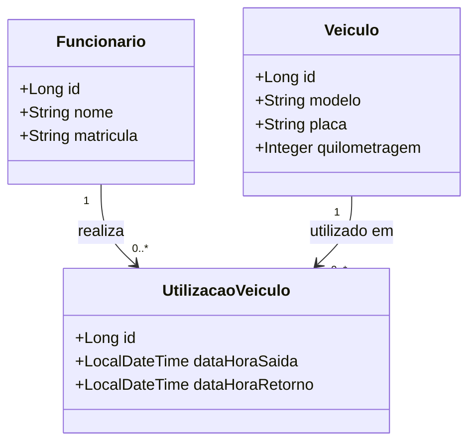

# Controle de Veículos

Documento de visão do projeto — AVA 1.

| Campo | Informação |
|---|---|
| **Aluno** | Vitor Emanuel de Lima Vodinciar |
| **Turma** | TEC-N-001788/2026 |
| **Opção escolhida** | Proposta própria |
| **Versão atual** | 0.1.0 |

---

## 1. Visão geral

### 1.1 Problema

Atualmente, a empresa não possui controle organizado sobre quem utiliza seus veículos, nem informações precisas sobre quando e por quanto tempo eles foram utilizados. Essa falta de rastreabilidade dificulta a análise de trajetos demorados e a identificação de quem utilizava um veículo no momento de uma multa ou de uma possível ocorrência de dano. Também prejudica o acompanhamento do histórico de utilização da frota. O sistema permitirá registrar e consultar essas informações para apoiar a gestão dos veículos.

### 1.2 Canvas do projeto

| Bloco | Resposta |
|---|---|
| **Usuários** | Funcionários que utilizam os veículos e administradores responsáveis pela frota. |
| **Problema** | Falta de registros organizados sobre os responsáveis pelos veículos e os períodos de utilização. |
| **Proposta de valor** | Facilitar o acompanhamento da frota, a análise dos períodos de utilização e a apuração de ocorrências. |
| **Funcionalidades principais** | Cadastro de funcionários e veículos, registro de saída e retorno e consulta do histórico de utilização. |
| **Informações que o sistema guarda** | Nome e matrícula do funcionário; modelo, placa e quilometragem do veículo; funcionário e veículo vinculados à utilização; datas e horários de saída e retorno. |
| **Indicadores** | Quem utilizou cada veículo, datas e horários de utilização e duração das utilizações concluídas. |
| **Restrições** | Projeto individual · Java 21 · Spring Boot 4 · entrega da versão 1.0 em 11/11/2026. |

---

## 2. Requisitos

### 2.1 Requisitos funcionais

| ID | Requisito | Nível |
|---|---|---|
| RF01 | O sistema deve permitir cadastrar, consultar, editar e excluir funcionários e veículos da empresa, respeitando os vínculos com registros de utilização. | Essencial |
| RF02 | O sistema deve permitir registrar a utilização de um veículo, informando o funcionário responsável, a data e o horário de saída. | Essencial |
| RF03 | O sistema deve permitir registrar a data e o horário de retorno do veículo utilizado. | Essencial |
| RF04 | O sistema deve permitir consultar o histórico de utilização dos veículos, exibindo os funcionários responsáveis, as datas e os horários de saída e retorno. | Essencial |

### 2.2 Requisitos não funcionais

| ID | Requisito |
|---|---|
| RNF01 | O sistema deve ser acessado pelo navegador, como aplicação web. |
| RNF02 | O sistema deve exigir login e senha, com senhas armazenadas como hashes seguros. |

### 2.3 Regras de negócio

| ID | Regra |
|---|---|
| RN01 | Todo registro de utilização deve estar vinculado a um funcionário e a um veículo cadastrados no sistema. |
| RN02 | A data e o horário de retorno de um veículo não podem ser anteriores à data e ao horário de saída da mesma utilização. |

---

## 3. Histórias de usuário

### HU01 — Cadastro de funcionários e veículos

Como administrador, quero cadastrar funcionários e veículos, para manter os dados necessários para o controle da frota.

- Critério de aceite: o sistema permite cadastrar funcionários com nome e matrícula e veículos com modelo, placa e quilometragem.
- Critério de aceite: os funcionários e veículos cadastrados ficam disponíveis para consulta nas respectivas listagens.

### HU02 — Registro de utilização

Como funcionário, quero registrar a utilização de um veículo, para que a empresa saiba quem está utilizando cada veículo.

- Critério de aceite: o registro exige um funcionário e um veículo cadastrados, além da data e do horário de saída.
- Critério de aceite: após salvar, a utilização pode ser consultada com as informações fornecidas.

### HU03 — Consulta do histórico

Como administrador, quero consultar o histórico de utilização dos veículos, para identificar os funcionários responsáveis e verificar os períodos de utilização.

- Critério de aceite: a consulta exibe o funcionário responsável, o veículo e as datas e os horários de saída e retorno; quando não houver retorno, indica que ele está pendente.
- Critério de aceite: utilizações anteriores permanecem disponíveis para consulta após o registro do retorno.

---

## 4. Modelo de dados



Cada utilização está vinculada a um funcionário e a um veículo. Um funcionário pode realizar várias utilizações, e um veículo pode ter várias utilizações no histórico.

---

## 5. Como executar

### No GitHub Codespaces

1. No repositório, clique em **Code → Codespaces** e abra o Codespace existente. Caso ainda não tenha um, clique em **Create codespace on main**.
2. Aguarde a preparação do ambiente.
3. No terminal, execute:

   ```bash
   mvn spring-boot:run
   ```

4. Quando aparecer o aviso da porta **8080**, clique em **Abrir no navegador**.
5. Para parar o sistema, clique no terminal e pressione **Ctrl + C**.

### No computador

Requisitos: JDK 21, Maven e uma IDE, como IntelliJ IDEA ou VS Code com o Extension Pack for Java.

1. Abra o projeto na IDE.
2. Execute a classe `SistemaApplication` ou o comando `mvn spring-boot:run` na pasta do projeto.
3. Acesse [http://localhost:8080](http://localhost:8080).

### Acesso

Contas de demonstração:

| Usuário | Senha | Perfil |
|---|---|---|
| admin | admin123 | Administrador |
| operador | operador123 | Operador |

O login passa a ser exigido a partir do Encontro 7.

---

## 6. Tecnologias

Java 21 · Spring Boot 4 · Spring MVC · Thymeleaf · Bootstrap 5 · Spring Data JPA · H2 (desenvolvimento) · MySQL (produção) · Spring Security · Git/GitHub.

## 7. Uso de inteligência artificial

A preencher pelo aluno conforme as orientações do curso.

## 8. Histórico de versões

| Versão | Data | Descrição |
|---|---|---|
| 0.1.0 | A preencher | Projeto inicial criado a partir do repositório modelo e elaboração do documento de visão. |