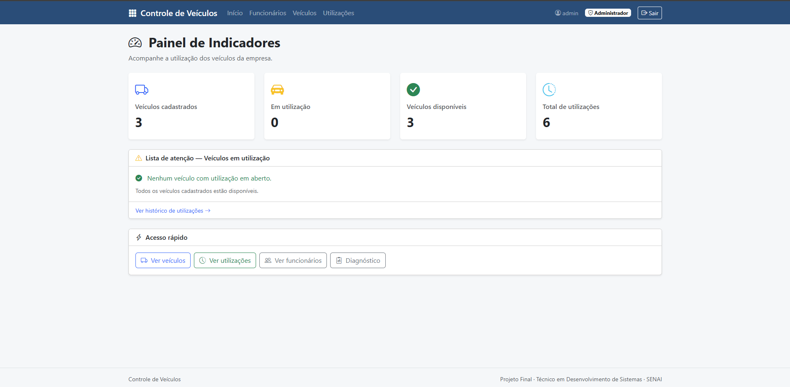
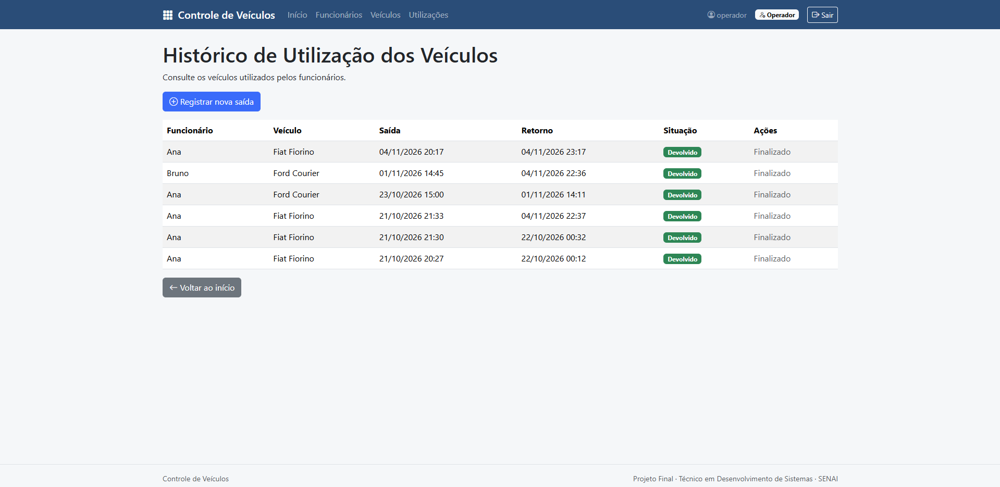
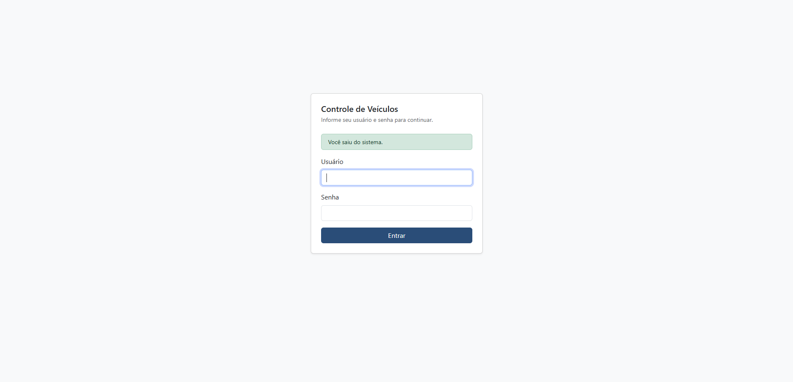

# Controle de Veículos

**Documento de visão e acompanhamento do projeto — SENAI**

Sistema web desenvolvido para controlar a utilização dos veículos de uma empresa, permitindo identificar os funcionários responsáveis, registrar saídas e devoluções e consultar o histórico de utilização da frota.

O projeto contempla cadastros, regras de negócio, autenticação, autorização por perfis, painel de indicadores e exclusão controlada de registros de utilização.

## Informações do projeto

| Campo | Informação |
|---|---|
| Aluno | Vitor Emanuel de Lima Vodinciar |
| Turma | TEC-N-001788/2026 |
| Opção escolhida | Proposta própria |
| Versão atual | 0.4.1 |
| Previsão de entrega da versão 1.0 | 11/11/2026 |
| Ambiente de desenvolvimento | GitHub Codespaces |
| Linguagem | Java 21 |
| Framework | Spring Boot 4 |

---

# 1. Visão geral

## 1.1 Problema

Atualmente, a empresa não possui controle organizado sobre quem utiliza seus veículos, nem informações precisas sobre quando e por quanto tempo eles foram utilizados.

Essa falta de rastreabilidade dificulta a análise de trajetos demorados e a identificação de quem utilizava um veículo no momento de uma multa ou de uma possível ocorrência de dano.

Também prejudica o acompanhamento do histórico de utilização da frota.

O sistema permitirá registrar e consultar essas informações para apoiar a gestão dos veículos.

## 1.2 Objetivo

Desenvolver uma aplicação web que permita:

- Cadastrar funcionários.
- Cadastrar veículos.
- Registrar saídas de veículos.
- Registrar devoluções.
- Consultar o histórico de utilizações.
- Identificar veículos disponíveis e em utilização.
- Impedir utilizações simultâneas do mesmo veículo.
- Controlar o acesso conforme o perfil do usuário.
- Visualizar indicadores sobre a frota.
- Excluir utilizações em aberto mediante autorização administrativa.

## 1.3 Canvas do projeto

| Bloco | Resposta |
|---|---|
| Usuários | Funcionários que utilizam os veículos, operadores e administradores responsáveis pela frota. |
| Problema | Falta de registros organizados sobre os responsáveis pelos veículos e os períodos de utilização. |
| Proposta de valor | Facilitar o acompanhamento da frota, a análise dos períodos de utilização e a apuração de ocorrências. |
| Funcionalidades principais | Cadastros, registro de saídas e devoluções, histórico, login, permissões, indicadores e exclusão controlada. |
| Informações armazenadas | Funcionários, matrículas, veículos, placas, quilometragem, datas, horários e situação das utilizações. |
| Indicadores | Veículos cadastrados, veículos em utilização, veículos disponíveis e total de utilizações. |
| Restrições | Projeto individual, Java 21, Spring Boot 4 e entrega da versão 1.0 em 11/11/2026. |

---

# 2. Requisitos

## 2.1 Requisitos funcionais

| ID | Requisito | Nível |
|---|---|---|
| RF01 | Cadastrar, consultar, editar e excluir funcionários e veículos, respeitando os vínculos existentes. | Essencial |
| RF02 | Registrar a utilização de um veículo, informando funcionário, veículo, data e horário de saída. | Essencial |
| RF03 | Registrar a data e o horário de retorno do veículo. | Essencial |
| RF04 | Consultar o histórico de utilização dos veículos. | Essencial |
| RF05 | Permitir autenticação por usuário e senha. | Essencial |
| RF06 | Controlar as permissões conforme os perfis ADMIN e OPERADOR. | Essencial |
| RF07 | Exibir painel com indicadores da frota e lista de atenção das utilizações em aberto. | Essencial |
| RF08 | Permitir que administradores excluam utilizações em aberto, mediante confirmação. | Adicional |

## 2.2 Requisitos não funcionais

| ID | Requisito |
|---|---|
| RNF01 | O sistema deve funcionar como aplicação web acessível pelo navegador. |
| RNF02 | O sistema deve exigir autenticação por login e senha no ambiente configurado com segurança ativa. |
| RNF03 | As senhas devem ser armazenadas utilizando hashes seguros, com BCrypt. |
| RNF04 | A interface deve utilizar Thymeleaf e Bootstrap 5. |
| RNF05 | O sistema deve utilizar banco de dados para persistir os registros. |

## 2.3 Regras de negócio

| ID | Regra |
|---|---|
| RN01 | Toda utilização deve estar vinculada a um funcionário e a um veículo cadastrados. |
| RN02 | O retorno não pode ocorrer antes da saída. |
| RN03 | Um veículo não pode possuir duas utilizações em aberto simultaneamente. |
| RN04 | Somente administradores podem cadastrar, editar e excluir funcionários e veículos. |
| RN05 | Administradores e operadores podem registrar saídas e devoluções. |
| RN06 | Usuários sem permissão não podem acessar funcionalidades restritas. |
| RN07 | O painel deve calcular os veículos disponíveis com base na quantidade cadastrada e nas utilizações em aberto. |
| RN08 | Somente administradores podem excluir utilizações, e apenas quando ainda não possuem devolução registrada. |

## 2.4 Situação da utilização

Cada utilização possui uma situação definida automaticamente pelo sistema.

| Situação | Descrição |
|---|---|
| EM_UTILIZACAO | O veículo foi retirado e ainda não possui retorno registrado. |
| DEVOLVIDO | O veículo já possui data e horário de retorno. |

As situações são representadas pelo enum `StatusUtilizacao`, armazenado como texto no banco de dados.

Na listagem, as situações são identificadas visualmente por cores.

Para utilizações em aberto, o sistema apresenta a opção de registrar devolução.

O administrador também pode excluir utilizações em aberto.

Os registros já finalizados permanecem disponíveis para consulta e não podem ser excluídos por essa funcionalidade.

---

# 3. Histórias de usuário

## HU01 — Cadastro de funcionários e veículos

Como administrador, quero cadastrar funcionários e veículos para manter os dados necessários ao controle da frota.

**Critérios de aceite:**

- Cadastrar funcionários com nome e matrícula.
- Cadastrar veículos com modelo, placa e quilometragem.
- Consultar os registros cadastrados.
- Permitir edição e exclusão conforme as regras de negócio.
- Validar os campos obrigatórios.

## HU02 — Registro de utilização

Como operador, quero registrar a utilização de um veículo para identificar quem está utilizando cada veículo da empresa.

**Critérios de aceite:**

- Selecionar funcionário e veículo cadastrados.
- Informar data e horário de saída.
- Impedir a retirada de veículos que já estejam em utilização.
- Permitir registrar a devolução.
- Impedir devolução anterior à saída.

## HU03 — Consulta do histórico

Como administrador, quero consultar o histórico de utilização dos veículos para identificar os responsáveis e verificar os períodos de utilização.

**Critérios de aceite:**

- Exibir funcionário responsável e veículo utilizado.
- Exibir data e horário de saída.
- Exibir data e horário de retorno.
- Identificar utilizações em aberto.
- Manter registros finalizados disponíveis para consulta.

## HU04 — Controle de acesso

Como administrador, quero controlar o acesso às funcionalidades para impedir alterações não autorizadas.

**Critérios de aceite:**

- Exigir login e senha.
- Identificar o usuário autenticado.
- Diferenciar os perfis ADMIN e OPERADOR.
- Restringir funcionalidades administrativas.
- Exibir uma página personalizada quando o acesso for negado.

## HU05 — Painel de indicadores

Como administrador ou operador, quero visualizar indicadores sobre os veículos para acompanhar a situação atual da frota.

**Critérios de aceite:**

- Exibir a quantidade total de veículos cadastrados.
- Exibir a quantidade de veículos em utilização.
- Exibir a quantidade de veículos disponíveis.
- Exibir a quantidade total de utilizações registradas.
- Atualizar os indicadores ao recarregar a página.
- Disponibilizar acesso rápido às principais funcionalidades.
- Exibir lista de atenção com utilizações ainda não devolvidas.

## HU06 — Exclusão controlada de utilizações

Como administrador, quero excluir utilizações registradas por engano ou durante testes, sem permitir a exclusão de utilizações já finalizadas.

**Critérios de aceite:**

- Exibir botão Excluir somente para administradores.
- Permitir exclusão apenas de utilizações em aberto.
- Solicitar confirmação antes da exclusão.
- Impedir exclusão de registros finalizados.
- Apresentar mensagem após a operação.
- Atualizar o histórico e os indicadores após a exclusão.
- Impedir que operadores utilizem a rota administrativa.

---

# 4. Modelo de dados

## 4.1 Entidades principais

### Funcionario

| Campo | Tipo |
|---|---|
| id | Long |
| nome | String |
| matricula | String |

### Veiculo

| Campo | Tipo |
|---|---|
| id | Long |
| modelo | String |
| placa | String |
| quilometragem | Integer |

### UtilizacaoVeiculo

| Campo | Tipo |
|---|---|
| id | Long |
| funcionario | Funcionario |
| veiculo | Veiculo |
| dataHoraSaida | LocalDateTime |
| dataHoraRetorno | LocalDateTime |
| status | StatusUtilizacao |

### StatusUtilizacao

Enum com os valores:

- EM_UTILIZACAO
- DEVOLVIDO

## 4.2 Relacionamentos

Cada utilização está vinculada a um funcionário e a um veículo.

Um funcionário pode realizar várias utilizações.

Um veículo pode possuir várias utilizações no histórico, desde que não existam duas utilizações em aberto simultaneamente.

O campo `status` representa a situação da utilização.

---

# 5. Segurança e perfis de acesso

A autenticação foi implementada utilizando Spring Security.

O sistema possui regras de autorização para controlar o acesso às funcionalidades conforme o perfil autenticado.

## 5.1 Perfis disponíveis

### ADMIN — Administrador

Responsável pelo gerenciamento dos cadastros, acompanhamento das utilizações e operações administrativas.

### OPERADOR — Operador

Responsável pelo registro de saídas e devoluções e pela consulta das informações cadastradas.

## 5.2 Permissões

| Funcionalidade | ADMIN | OPERADOR |
|---|---|---|
| Consultar funcionários | Sim | Sim |
| Cadastrar funcionários | Sim | Não |
| Editar funcionários | Sim | Não |
| Excluir funcionários | Sim | Não |
| Consultar veículos | Sim | Sim |
| Cadastrar veículos | Sim | Não |
| Editar veículos | Sim | Não |
| Excluir veículos | Sim | Não |
| Consultar utilizações | Sim | Sim |
| Registrar saída | Sim | Sim |
| Registrar devolução | Sim | Sim |
| Excluir utilização em aberto | Sim | Não |
| Acessar painel de indicadores | Sim | Sim |

## 5.3 Página de acesso negado

Quando um usuário tenta acessar uma funcionalidade sem permissão, o sistema retorna o código HTTP 403 — Forbidden.

Foi implementada uma página personalizada que apresenta a mensagem:

**Acesso negado**

O seu perfil não tem permissão para acessar esta página ou realizar esta ação.

A página também apresenta um botão para retornar ao início.

## 5.4 Interface conforme o perfil

O sistema utiliza `sec:authorize` do Thymeleaf para controlar a exibição de elementos da interface.

Os botões de cadastro, edição e exclusão administrativa são apresentados conforme o perfil.

O menu identifica o usuário autenticado e seu perfil.

A ocultação dos botões complementa as regras de autorização configuradas no Spring Security.

## 5.5 Segurança da exclusão de utilizações

A exclusão de utilizações utiliza:

- Requisição HTTP POST.
- Restrição de acesso ao perfil ADMIN.
- Confirmação na interface.
- Validação no Service.
- Mensagens de sucesso ou erro.

A configuração `SecurityConfig.java` contém a regra:

```java
.requestMatchers("/utilizacoes/*/excluir")
.hasRole("ADMIN")
```

Essa regra protege a rota quando a segurança da aplicação está ativa.

O Service também verifica se a utilização possui data de retorno.

Se o registro estiver finalizado, a exclusão será impedida.

---

# 6. Painel de indicadores

## 6.1 Objetivo

O painel de indicadores foi desenvolvido no Encontro 8 para facilitar o acompanhamento da frota.

A página inicial apresenta informações resumidas e atualizadas com base nos registros existentes no banco de dados.

## 6.2 Indicadores implementados

### 1. Veículos cadastrados

Apresenta a quantidade total de veículos registrados no sistema.

### 2. Veículos em utilização

Apresenta a quantidade de veículos com utilização em aberto.

### 3. Veículos disponíveis

Apresenta a quantidade de veículos cadastrados que não estão em utilização.

**Cálculo:**

```text
Disponíveis = Total de veículos - Veículos em utilização
```

### 4. Total de utilizações

Apresenta a quantidade total de registros de utilização, incluindo registros finalizados e ainda em aberto.

## 6.3 Implementação

O painel utiliza as tecnologias já presentes no projeto:

- Java 21.
- Spring Boot 4.
- Spring MVC.
- Thymeleaf.
- Bootstrap 5.
- Spring Data JPA.
- Banco de dados H2.

O arquivo `InicioController.java` consulta as informações utilizando os serviços existentes.

O `VeiculoService` fornece a lista de veículos cadastrados.

O `UtilizacaoVeiculoService` fornece o histórico de utilizações.

Os veículos em utilização são identificados pelos registros que ainda não possuem data de retorno.

Os valores calculados são enviados à página `index.html` por meio do Model do Spring MVC.

## 6.4 Interface visual

A página inicial apresenta quatro cartões com os indicadores da frota.

Cada cartão possui um ícone, uma descrição e o número correspondente.

O painel também apresenta a **Lista de Atenção — Veículos em utilização**, mostrando:

- Funcionário responsável.
- Modelo do veículo.
- Data e hora da saída.
- Situação da utilização.

A lista é ordenada pela data de saída, das utilizações mais antigas para as mais recentes.

Quando não houver utilizações em aberto, aparece a mensagem:

**Nenhum veículo com utilização em aberto.**

O painel também possui uma seção de acesso rápido:

- Ver veículos.
- Ver utilizações.
- Ver funcionários.
- Diagnóstico.

## 6.5 Atualização das informações

Os indicadores são calculados novamente quando a página inicial é acessada ou recarregada.

Após o registro de uma devolução:

- A quantidade de veículos em utilização diminui.
- A quantidade de veículos disponíveis aumenta.
- O total de utilizações permanece inalterado.

Após a exclusão de uma utilização em aberto:

- O veículo deixa de estar em utilização.
- A quantidade de veículos disponíveis aumenta.
- O total de registros de utilização diminui.
- A Lista de Atenção deixa de apresentar o registro excluído.

---

# 7. Como executar

## 7.1 GitHub Codespaces

1. Abra o repositório no GitHub.
2. Clique em **Code → Codespaces**.
3. Abra o Codespace existente ou crie um novo.
4. Aguarde a preparação do ambiente.
5. No terminal, execute:

```bash
mvn spring-boot:run -Dspring-boot.run.profiles=dev
```

6. Aguarde a mensagem `Started SistemaApplication`.
7. Abra a aba **Portas**.
8. Na porta 8080, clique no ícone de globo para abrir a aplicação.
9. Utilize uma das contas de demonstração.

Para encerrar a aplicação, pressione `Ctrl + C` no terminal.

## 7.2 Execução no computador

Requisitos:

- JDK 21.
- Maven.
- IntelliJ IDEA ou VS Code com suporte a Java.

Abra o projeto na IDE e execute a classe `SistemaApplication` ou utilize:

```bash
mvn spring-boot:run -Dspring-boot.run.profiles=dev
```

A aplicação ficará disponível em:

http://localhost:8080

## 7.3 Usuários de demonstração

| Usuário | Senha | Perfil |
|---|---|---|
| admin | admin123 | ADMIN |
| operador | operador123 | OPERADOR |

Essas credenciais são destinadas exclusivamente ao ambiente de demonstração e desenvolvimento.

Devem ser substituídas antes de qualquer utilização em produção.

## 7.4 Banco de dados

Durante o desenvolvimento, o sistema utiliza H2 com persistência em arquivo.

Configuração principal:

```yaml
spring:
  datasource:
    url: "jdbc:h2:file:./dados/banco;MODE=MySQL;DATABASE_TO_LOWER=TRUE;CASE_INSENSITIVE_IDENTIFIERS=TRUE"
    username: sa
    password: ""
```

O banco mantém os registros entre as execuções da aplicação.

A pasta `dados/` contém o banco de desenvolvimento e não deve ser enviada ao GitHub.

---

# 8. Tecnologias

| Tecnologia | Utilização |
|---|---|
| Java 21 | Linguagem de programação |
| Spring Boot 4 | Estrutura principal da aplicação |
| Spring MVC | Controllers e requisições web |
| Spring Data JPA | Persistência de dados |
| H2 | Banco de dados de desenvolvimento |
| MySQL | Banco de dados previsto para produção |
| Thymeleaf | Renderização das páginas |
| Bootstrap 5 | Interface responsiva |
| Spring Security | Autenticação e autorização |
| BCrypt | Hash de senhas |
| Maven | Gerenciamento de dependências |
| Git e GitHub | Versionamento do projeto |

---

# 9. Testes realizados

## 9.1 Sprint 2 — Controle de utilizações

Foram testados:

- Cadastro e consulta de funcionários.
- Cadastro e consulta de veículos.
- Registro de saída.
- Registro de devolução.
- Bloqueio de utilização simultânea do mesmo veículo.
- Consulta do histórico de utilizações.
- Identificação visual das situações.

## 9.2 Sprint 3 — Segurança

Foram testados:

- Exibição da tela de login.
- Autenticação com usuário OPERADOR.
- Bloqueio do acesso a `/funcionarios/novo` para OPERADOR.
- Bloqueio do acesso a `/veiculos/novo` para OPERADOR.
- Exibição da página personalizada de erro 403.
- Ocultação dos botões administrativos na lista de funcionários.
- Ocultação dos botões administrativos na lista de veículos.
- Exibição do perfil OPERADOR no menu.

## 9.3 Sprint 4 — Painel de indicadores

O painel foi implementado e testado em 04/11/2026.

### Teste inicial

| Indicador | Resultado |
|---|---|
| Veículos cadastrados | 3 |
| Veículos em utilização | 2 |
| Veículos disponíveis | 1 |
| Total de utilizações | 5 |

### Teste após as devoluções

| Indicador | Resultado |
|---|---|
| Veículos cadastrados | 3 |
| Veículos em utilização | 0 |
| Veículos disponíveis | 3 |
| Total de utilizações | 5 |

### Teste adicional do Encontro 9

Após registrar e devolver outro veículo:

| Indicador | Resultado |
|---|---|
| Veículos cadastrados | 3 |
| Veículos em utilização | 0 |
| Veículos disponíveis | 3 |
| Total de utilizações | 6 |

Os testes confirmaram que:

- Os indicadores foram exibidos corretamente.
- As quantidades corresponderam aos registros existentes.
- O sistema reconheceu as devoluções.
- A quantidade de veículos disponíveis foi atualizada.
- O total de utilizações permaneceu correto após as devoluções.
- O painel funcionou com o perfil OPERADOR.
- Os botões de acesso rápido foram apresentados.
- A Lista de Atenção foi exibida corretamente.
- O bloqueio de uma segunda saída para o mesmo veículo funcionou.

## 9.4 Encontro 9 — Testes de estabilização

Foram realizados:

- Cadastro, edição e exclusão de funcionário de teste.
- Validação dos campos obrigatórios de funcionário.
- Cadastro, edição e exclusão de veículo de teste.
- Validação dos campos obrigatórios de veículo.
- Registro de saída.
- Bloqueio de uma segunda saída do mesmo veículo.
- Registro de devolução.
- Atualização dos indicadores após devolução.
- Verificação das restrições do perfil OPERADOR.

## 9.5 Teste da RN02 — Retorno anterior à saída

Foi registrado um veículo com data e horário de saída futuros.

Ao tentar registrar a devolução antes do horário informado, o sistema apresentou a mensagem:

**O retorno não pode ser anterior à saída.**

A operação foi bloqueada.

**Resultado: APROVADO.**

A validação foi confirmada na interface e já estava implementada no `UtilizacaoVeiculoService.java`.

## 9.6 Teste da exclusão de utilizações

Foi implementada a funcionalidade adicional de exclusão de utilizações em aberto.

O teste foi realizado com o perfil ADMIN.

Procedimento:

1. Acessar o histórico de utilizações.
2. Localizar o registro fictício em aberto do veículo Honda Cargo.
3. Clicar no botão Excluir.
4. Confirmar a operação.
5. Verificar a remoção do registro.

Resultado informado:

**Utilização excluída com sucesso.**

O registro deixou de aparecer no histórico.

**Resultado: APROVADO.**

## 9.7 Teste de visibilidade por perfil

Foi realizado login utilizando o perfil OPERADOR.

Na tela de histórico, foi verificado que o botão Excluir não era apresentado.

**Resultado: APROVADO.**

A rota de exclusão também possui restrição para ADMIN no Spring Security.

O teste manual específico de acesso direto à rota de exclusão pelo OPERADOR não foi executado.

## 9.8 Limitações dos testes

Algumas verificações permanecem pendentes:

- Teste manual de acesso direto à rota de exclusão pelo OPERADOR.
- Verificação completa das restrições de exclusão envolvendo todos os vínculos entre entidades.
- Revisão de usabilidade por outro usuário.

Essas pendências não devem ser consideradas testes aprovados.

---

# 10. Exclusão controlada de utilizações

## 10.1 Objetivo

Permitir que o administrador remova registros de utilização criados incorretamente ou durante testes.

A funcionalidade foi desenvolvida no Encontro 9.

## 10.2 Funcionamento

Na página de histórico de utilizações, o perfil ADMIN visualiza o botão **Excluir** ao lado do botão **Devolver**, para registros ainda em aberto.

Ao clicar em Excluir, o navegador apresenta uma confirmação.

Se o administrador confirmar, o sistema envia uma requisição POST ao Controller.

O Controller chama o Service responsável pela exclusão.

Antes da remoção, o Service verifica se existe data de retorno.

Caso o registro esteja finalizado, a exclusão é impedida.

## 10.3 Arquivos modificados

- `UtilizacaoVeiculoController.java`
- `UtilizacaoVeiculoService.java`
- `templates/utilizacoes/lista.html`

## 10.4 Restrições

- Somente ADMIN pode executar a exclusão.
- Utilizações finalizadas não podem ser excluídas.
- A exclusão exige confirmação.
- O servidor valida a operação.
- A exclusão remove o registro do histórico.

## 10.5 Possível melhoria futura

Em uma aplicação destinada ao uso empresarial, seria interessante substituir a exclusão definitiva por cancelamento lógico.

Nesse modelo, o registro continuaria armazenado para auditoria, mas seria identificado como cancelado.

Essa melhoria não faz parte da implementação atual.

---

# 11. Uso de inteligência artificial

Durante o desenvolvimento, foi utilizado o ChatGPT como ferramenta de apoio para:

- Compreender conceitos de Java e Spring Boot.
- Interpretar requisitos do projeto.
- Auxiliar na implementação de funcionalidades.
- Identificar e corrigir problemas no código.
- Compreender regras de autenticação e autorização.
- Organizar e atualizar a documentação.
- Auxiliar na construção do painel de indicadores.
- Implementar a exclusão controlada de utilizações.
- Interpretar os resultados dos testes.

O desenvolvimento foi acompanhado por testes manuais no ambiente GitHub Codespaces.

---

# 12. Histórico de versões

| Versão | Data | Descrição |
|---|---|---|
| 0.1.0 | A preencher | Criação do projeto e elaboração do documento de visão. |
| 0.2.0 | 21/10/2026 | Cadastros, registro de utilizações, devoluções e regras de negócio. |
| 0.3.0 | 01/11/2026 | Login, perfis de acesso, página 403 e controle visual de permissões. |
| 0.4.0 | 04/11/2026 | Painel de indicadores, Lista de Atenção e testes de atualização após devoluções. |
| 0.4.1 | 04/11/2026 | Exclusão administrativa de utilizações em aberto, teste da RN02, validação da interface por perfil e atualização da documentação. |

---

# 13. Próximas etapas

- Conferir o checklist final do AVA 5.
- Atualizar o Kanban no GitHub Projects.
- Revisar a documentação publicada.
- Verificar se as imagens aparecem corretamente.
- Confirmar a versão final do sistema.
- Preparar a demonstração das funcionalidades.
- Concluir a versão 1.0 até 11/11/2026.

---

# 14. Situação atual do projeto

**Versão:** 0.4.1

**Data da atualização:** 04/11/2026

## Funcionalidades implementadas

- Cadastro de funcionários.
- Cadastro de veículos.
- Registro de utilização.
- Registro de devolução.
- Histórico de utilizações.
- Controle de disponibilidade.
- Bloqueio de utilizações simultâneas.
- Validação de retorno anterior à saída.
- Autenticação por login e senha.
- Perfis de acesso ADMIN e OPERADOR.
- Página personalizada de acesso negado.
- Painel com quatro indicadores.
- Lista de Atenção.
- Acesso rápido às funcionalidades principais.
- Exclusão de utilizações em aberto por administradores.
- Confirmação de exclusão.
- Proteção de registros finalizados contra exclusão.

O projeto permanece em desenvolvimento, com entrega da versão 1.0 prevista para 11/11/2026.

---

# 15. Funcionalidades e telas

## 15.1 Funcionalidades principais

O sistema permite:

- Cadastro, consulta, edição e exclusão de funcionários e veículos.
- Registro de saídas e devoluções.
- Consulta do histórico de utilizações.
- Identificação dos veículos em utilização.
- Bloqueio de duas utilizações simultâneas.
- Login e autorização por perfil.
- Exibição de página de acesso negado.
- Visualização dos indicadores da frota.
- Consulta da Lista de Atenção.
- Exclusão administrativa de utilizações em aberto.

## 15.2 Capturas de tela

### Painel de indicadores e Lista de Atenção



### Histórico de utilizações



### Tela de login



### Diferença entre os perfis — Funcionários


### Diferença entre os perfis — Veículos


## 15.3 Regra de negócio — Bloqueio de utilização duplicada

A regra RN03 foi testada.

Ao tentar registrar uma segunda saída para um veículo que ainda não foi devolvido, o sistema impede a operação.

A captura `docs/regra.png` poderá ser adicionada posteriormente.

## 15.4 Exclusão administrativa

A tela de histórico passou a apresentar o botão Excluir para administradores.

A funcionalidade foi testada com um registro fictício do veículo Honda Cargo.

Uma nova captura de tela poderá ser adicionada à documentação para demonstrar a funcionalidade.

---

# 16. Checklist do nível essencial — AVA 5

Os itens marcados com `[x]` foram implementados e verificados conforme os testes realizados.

Os itens `[ ]` permanecem pendentes ou não foram executados.

## 16.1 Aplicação

- [x] Sistema inicia pelo Codespaces sem erros nos testes realizados.
- [x] Cadastro de funcionários: listar, cadastrar, editar, excluir e validar campos obrigatórios.
- [x] Cadastro de veículos: listar, cadastrar, editar, excluir e validar campos obrigatórios.
- [x] Registro de utilização vinculado a funcionário e veículo cadastrados.
- [x] Registro de devolução.
- [x] Atualização da disponibilidade após devolução.
- [x] Consulta do histórico de utilizações.

## 16.2 Regras de negócio

- [x] RN02: impedir devolução anterior à saída.
- [x] RN03: impedir duas utilizações em aberto para o mesmo veículo.
- [x] Exclusão administrativa de utilização em aberto.
- [x] Impedir exclusão de utilização finalizada, conforme validação implementada no Service.
- [ ] Confirmar manualmente todas as restrições de exclusão de registros vinculados.

## 16.3 Segurança

- [x] Login e autenticação.
- [x] Dois perfis com permissões diferentes.
- [x] Bloqueio do OPERADOR em páginas administrativas.
- [x] Página personalizada de erro 403.
- [x] Botão Excluir oculto para OPERADOR.
- [x] Rota de exclusão configurada para ADMIN no Spring Security.
- [ ] Testar manualmente o acesso direto à rota de exclusão pelo OPERADOR.

## 16.4 Painel

- [x] Indicador de veículos cadastrados.
- [x] Indicador de veículos em utilização.
- [x] Indicador de veículos disponíveis.
- [x] Indicador do total de utilizações.
- [x] Lista de Atenção.
- [x] Atualização dos indicadores após devolução.
- [x] Acesso rápido às funcionalidades.

## 16.5 GitHub e documentação

- [x] Histórico de commits no GitHub.
- [x] README com visão do projeto.
- [x] README com requisitos e regras de negócio.
- [x] README com instruções de execução.
- [x] README com usuários de demonstração.
- [x] README com documentação dos testes.
- [x] Capturas de tela adicionadas à pasta docs.
- [x] Tag `base-essencial` criada e enviada ao GitHub.
- [x] Conferir se todas as imagens aparecem corretamente no README publicado.
- [x] Atualizar e conferir o Kanban no GitHub Projects.
- [ ] Realizar revisão de usabilidade por um colega (atividade não realizada).

---

# 17. Organização do projeto no GitHub

O projeto utiliza Git e GitHub para registrar o desenvolvimento.

Foram realizados commits ao longo das etapas para documentar as funcionalidades implementadas.

A tag `base-essencial` identifica uma versão de referência do projeto.

O GitHub Projects é utilizado para acompanhar as atividades por meio do quadro Kanban.

As atividades são organizadas conforme o andamento:

- Todo: atividades pendentes.
- In Progress: atividades em desenvolvimento.
- Done: atividades concluídas.

A documentação será mantida no arquivo README.md.

---

# 18. Entrega final

A versão 1.0 está prevista para 11/11/2026.

Para a entrega do AVA 5, deverão estar disponíveis:

- Link do repositório no GitHub.
- README atualizado.
- Checklist do nível essencial.
- Histórico de commits.
- Kanban atualizado.
- Evidências das funcionalidades implementadas.

O objetivo é apresentar um sistema funcional, documentado e capaz de demonstrar o controle de utilização dos veículos de uma empresa.

---

**Projeto Final — Técnico em Desenvolvimento de Sistemas — SENAI**

**Aluno:** Vitor Emanuel de Lima Vodinciar

**Turma:** TEC-N-001788/2026
